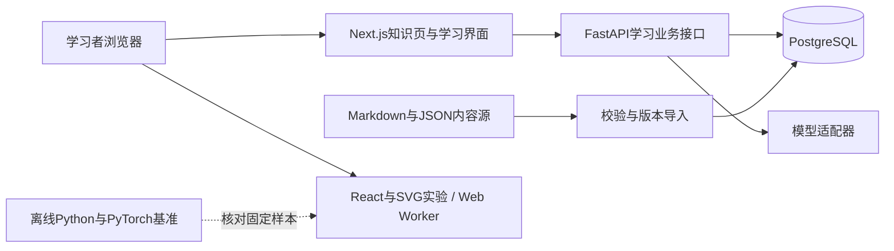

# 首版系统架构

更新日期：2026-11-09。状态：以下为完整设计基线，已有九章与本地学习闭环，尚未整体验收。实际接口、运行方式与未实现部分见[本地开发说明](./local-development.md)。

当前已接通Next.js、FastAPI与PostgreSQL；已完成内容版本导入、局部图手动保存、草稿暂存、历史恢复、幂等/冲突处理和固定TF-Q04实验。一步领航和角色复核已有工程首版，模型适配与正式掌握投影仍为设计。地图提交保存完整有界快照及操作摘要，尚未逐事件记录每次拖动和编辑。

默认页面现为迷雾群岛游戏，只读取最小探索进度；三步机关通过后才显示一个知识发现。原整理界面保留在/workbench，游戏进度与个人图谱分开存储。“我的星图”通过只读discoveries接口读取实际探索来处，按发现筛选同一份个人图；写解释和关系仍走learner-graph修订接口，不自动推进游戏或赋予掌握。具体机制见[游玩体验](./game-experience.md)与[个人星图](./personal-star-map.md)。

回声小岛后按进度读取分光台的独立阶段，仍只展示当前主要入口。背景音乐为本地静态WAV，客户端主动播放，与学习接口独立。多Agent的目标角色、统一运行契约与Provider边界见[多Agent设计](./agent-system.md)，尚未实现。

当前已用chapter配置与独立路由扩展为信息之海第一章，添加查询匹配、多头支线和综合灯塔。GET chapter汇总5个探索点，按前置探索揭示名称，分别计算4点主线完成与全探索完成；POST chapter/{node}/moves验证新3点的数值、阶段和机制链。数据仍复用探索表，主线完成不更新掌握投影。详见[局部地图](./information-sea-map.md)。

## 1. 服务分工

关系修订独立路由复用verification_sessions追加relation_revision事件。提交依次锁验证室、来源复核和图头，检查三份修订并在同一事务生成图快照/操作与足迹，只改边的label/note。任务读当前意见，足迹固定当时依据；本人修订不改变候选/解锁，见[修订任务](./relation-revisions.md)。

关系验证在verification开始事件固定原连线五字段、图修订与模板副本，不给图中连线写可信掌握字段。relation-evidence只读对照当前命题；candidates在关系变更时标为待重新核对，节点星图摘要排除关系绑定作答。原文引用进入题面和量规，由复核者核查语义，见[关系绑定](./relation-evidence.md)。

个人星图从star-evidence读取窄范围稳定实体映射、当前状态数量和局部来源，不把状态混入节点JSON。画布徽标通过组件上下文呈现，历史图始终保留原载荷；证据故障不阻塞图编辑/保存。跨入口用目标/作答/来源ID精确定位，读取失败不回退成其他记录，见[星图证据](./star-evidence.md)。

候选证据由只读candidates投影联合固定作答与当前复核计算，初次和复验各自准入，来源变化立即重算，不写个人图或掌握。复验开始复用验证室事务，锁验证室后锁来源复核，并重新读取来源修订检查72小时门槛；观察为复核者的有据声明，非系统证明现实独立性。规则和题目版本随复验保存，见[候选证据](./candidate-evidence.md)。

角色复核通过review_actors随机钥匙摘要识别身份，review_cases按作答保存追加意见与本人纠正链；原作答/本人复盘不被改写。摘要按各身份最新逐项判断计算分歧/一致/需补充，不参与自动解锁。Bearer每次请求检查，角色和操作键绑定服务端身份。当前仍为本机学习档案加配置式复核身份，完整多用户与真人独立性认证尚未实现，见[复核权限](./reviewing.md)。

新情境验证以verification_sessions独立保存start/submit/self_review事件。开始时固定私有题目/量规和当时图谱修订，提交后才公开该次参考关系与量规。数值/选择规则可确定检查；解释与本人复盘均保持待独立复核，不写掌握投影。原文不可覆盖、复盘追加，详情见[验证与量规](./verification.md)。

一步领航首版通过guidance接口合并真实可达探索、相关画像和独立领航历史，按本步反馈提供局部支持；guidance_sessions保存规则/内容版本与动作结果，不改写探索、画像或个人图。四类固定补桥之外明确报覆盖缺口，不能把规则回退当模型生成或正式掌握评价。详见[领航与补桥](./guidance.md)。

初始画像首版独立保存于intake_sessions：只读GET与answer/hint/finish动作接口，事务锁、幂等和修订冲突沿用相同原则。探测结果只用于粗略建议，不改探索解锁、个人图或掌握投影；具体内容、分支及限制见[入门画像](./intake.md)。



前端不直连数据库；学习状态由FastAPI验证并写入。模型、数据库与内容源分别有版本，不能混成一个“当前版本”。

## 2. 一次学习怎样发生

1. 浏览器读取当前内容版本、个人目标、已验证证据与待补缺口。
2. API根据先修和证据规则推荐一个可够到的任务，并给出推荐理由。
3. 前端只加载当前任务所需的局部图、正文和实验，按需展开其他节点。
4. 玩家预测、操作和解释；前端暂存草稿，API记录作答及提示使用。
5. 可确定的数值/结构检查先按规则评价；需要解释评价时再按配置调用模型。
6. API保存评价依据和内容/任务/量规版本，更新证据投影；有关键矛盾时保留待复核状态。
7. 玩家修订个人图谱，保存新版本；系统重新选下一任务，而不一次固化整条路线。

## 3. 前端边界

- 可阅读知识页与导航使用Next.js页面层，地图与实验使用客户端组件。
- React Flow承担画布，不将其图对象直接当权威学习数据；界面布局与概念/关系身份分开。
- React局部状态保存当前拖动、选择与未提交输入；TanStack Query处理服务端读取与提交状态。
- 浏览器用IndexedDB暂存待提交操作与草稿，并显示未同步状态；服务端成功确认后才称为已持久化。
- 对图拖动结束、解释修改、连线与删除分别记录操作；不按每个鼠标像素刷出历史版本。
- 过关答案与服务端凭据不进入客户端打包内容。SVG图、正文和代码高亮只接收限定格式的数据。

## 4. 保存、冲突与恢复

每个学习图有递增revision（修订号）。提交包含基于的revision和唯一操作键。

一个数据库事务中：检查当前revision、记录操作、写入新快照、更新图头。重复操作键返回既有结果；过期revision返回冲突，前端保留本地草稿并提示合并/重新应用，不能静默覆盖另一个标签页。

阶段提交引用不可覆盖的图快照及当时评价。恢复旧图复制成一个新revision，保留原来的后续版本，不更改历史成绩。当前内容变更时，旧图仍能解析到原内容版本。

初版可保存有界个人局部图的完整快照；若后续容量测量需要优化，再做操作压缩与快照间隔。不能把“以后可压缩”当作现在允许删除历史。

## 5. 内容发布与持续维护

现有 `data/` 与 `knowledge/` 继续作为内容源，不迁走或重编号。导入过程校验ID、来源、关系、成熟度、文件路径与版本；数据库为服务运行副本。

导入草稿与发布版本区分。内部开发可读带标记的草稿，公开学习目录只展示允许发布的内容；草稿的题量或字段完整性不能代替审校。

公共内容、练习提示、独立题与量规导出策略分开。对外部署前检查接口实际响应和前端产物，确保量规不因整份JSON导入而被顺带公开。

## 6. API契约草案

| 接口 | 用途 |
| --- | --- |
| `GET /api/v1/content/releases/current` | 当前可使用的内容版本 |
| `GET /api/v1/graph/neighborhood` | 按中心ID、版本、深度与数量限制读取局部图 |
| `GET /api/v1/topics/{id}` | 读取专题及可公开模块数据 |
| `POST /api/v1/attempts` | 提交作答和提示/实验证据 |
| `POST /api/v1/recommendations` | 根据当前证据选择下一任务 |
| `GET /api/v1/learner-graphs/{id}/versions` | 图版本目录 |
| `POST /api/v1/learner-graphs/{id}/operations` | 带revision与操作键提交修订 |
| `POST /api/v1/learner-graphs/{id}/restore` | 从旧快照创建新版本 |
| `POST /api/v1/tutor/messages` | 按上下文与来源版本请求讲解，后续可流式返回 |

上表保留目标契约。当前原型采用单档案的`/learner-graph`等简化路径，详见本地开发说明。FastAPI已经输出OpenAPI；前端类型生成尚未实现，当前手写接口类型不充当数据库模型。错误响应区分内容不存在、版本冲突和无效请求；解释结果单独保持待复核。

## 7. 代码组织

```text
apps/web/              Next.js、React、图谱、实验和页面
apps/api/              FastAPI、领域规则、模型适配与数据库模型
packages/contracts/   由OpenAPI生成的前端类型
data/                 现有实体、来源、任务与量规源文件
knowledge/            现有中文正文、图解与模块文档
examples/             可复现的教学计算基准
scripts/              内容导入、校验与构建辅助
infra/                后续本地与部署配置
tests/                现有检查，后续按边界补应用检查
```

`apps/web`、`apps/api`与本地启动/检查脚本已创建；`packages/contracts`和`infra`仍未建立。首版不引入额外微服务、远程代码执行平台或自动训练集群。

## 8. 首个工程里程碑

工程初始化后，只验证一条闭环：从Transformer专题进入“不能看未来”的任务，修改掩码并观察，提交解释，修订一条个人关系，刷新后恢复，再恢复旧版形成新revision。

至少覆盖：数据来自导入版本、计算与Python基准一致、证据可追溯、恢复不覆盖历史、冲突不丢草稿、模型不可用时仍可学习固定内容。此阶段通过后再扩大关卡与模型调用。

该工程闭环已通过真实数据库与浏览器检查；目前未调用任何模型，固定内容与规则不依赖模型服务。教学有效性、完整网络重试覆盖和自适应仍未验证。

多章扩展沿用这条边界：`expedition.json`声明探索顺序与实体引用，正文进入ContentRelease；前端实现切分、查表、训练与生成的固定交互，FastAPI独立复算并校验阶段。每点使用独立AdventureSession，主线与可选支线分别统计。详细范围见[四章光路](./light-expedition.md)。探索顺序不作为公共知识图谱的数学先修关系，也不改变个人图谱的掌握状态。

第五章的数值机制独立放在`apps/api/app/tower.py`和`apps/web/src/lib/tower.ts`，交互放在`TowerLab`，沿用统一阶段接口。总览数量从版本化配置计算。LayerNorm与链式梯度另对照独立解析值/中心差分；Pre-LN拼装只校验结构，不伪装真实模型执行。工作台浏览器回归使用内存夹具隔离个人数据，真实持久化与并发由独立数据库Schema验证。

优化营地/解码航线使用两端独立的`voyage`数值模块和`VoyageLab`交互，仍复用统一阶段接口及AdventureSession。有限梯度回放、候选过滤和固定点抽取都由有界输入确定计算；停止实验同时限制EOS与新增数量，并检查请求步数等于实际新增数，拒绝终止后虚增步骤。配置版本升至v3，新正文进入内容哈希，仅补缺失会话，不覆盖旧图或引入新迁移。

现代架构工坊/泛化试验场由前后端独立`frontier`数值模块和`FrontierLab`交互承载。新增状态显式限制归一化类型、位置、K/V组数、分区、拟合范围及候选参数；配置版本v4，八份扩展正文纳入哈希。GQA输出和标量计数分别计算，分组泄漏与数量条件分开校验，Min-Max仅按选定训练范围拟合；几何与解析误差使用独立参照检查。沿用原事件、幂等、冲突与旧图保留机制。
