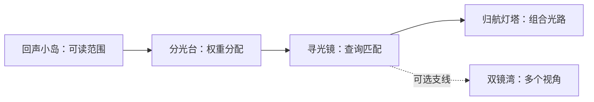

# 信息之海：把当前局部地图打通

日期：2026-11-07。范围：首个局部游戏章节。用户明确本轮先打通当前地图，熟练度与刷题机制后置。本章完成不代表160条公共目录已游戏化，也不代表掌握完整Transformer。

## 1. 有边界的旅程

四个主线探索点完成，即“本章主线连通”；支线双镜湾完成，才是“本章所有探索点完成”。两种状态分别记录。支线不是必须清空的待办，也不把探索顺序当作所有数学概念的硬性先修。

首屏仍只保留当前主要入口。完整航图从“展开这一程航图”或“更多→这一程的航图”主动打开。锁定区域只显示迷雾，满足相邻探索条件后才出现名称与小目标；已发现点可在航图重游。

## 2. 每个点带走什么

| 探索点 | 三个渐进机关 | 玩家带走的关系 |
| --- | --- | --- |
| 回声小岛 | 改未来值；开关光闸；保护前缀并增强后方 | 因果掩码控制读取范围，未来值不能越过边界影响前缀 |
| 分光台 | 相同偏好；偏向第三束；重心转回第一束 | 分数经Softmax成为权重，再按比例汇聚值 |
| 寻光镜 | 第二把键最匹配；同时关注两个方向；转回低值信息并解释 | Query查询与Key键产生匹配分数，Value值参与汇聚 |
| 双镜湾（支线） | A保持低值；B关注高值；拼接保留两个输出 | 不同头有自己的查询和权重；拼接不等于平均或择优保留一个 |
| 归航灯塔 | 修复未来读取；改变未来值而前缀保持；重建四步计算链 | 匹配、屏蔽、归一化、汇聚是一条相连的计算过程 |

合计15个小机关，其中12个为主线。每次展开一个目标，保留局部提示；第三步适当组合或解释，不在开头列出全部术语与公式。

## 3. 操作与反馈

世界中继续使用方向键/WASD移动光灵、点击地面前往、近光点亮。寻光镜、双镜湾与综合灯塔中，用二维查询盘拖动或方向键/WASD调整查询；保留两个坐标滑块作为可访问的等价操作。

双镜湾可点击A/B或用1/2切换镜片；两个输出始终并列保留。综合灯塔可切换因果光闸、改变第三个值，看到三个查询位置的输出。最后按顺序点击机制卡，可逐步撤回重接。

通过时保存阶段；未通过时保留配置并给局部原因。刷新后重新进入最近已保存的阶段，未过关的临时拖动状态不保证恢复。重游只重置本次场景，不覆写已记录航迹。

## 4. 数据与验收

章节配置在 `data/games/information-sea.json`，教学细节在 [章节机制说明](../knowledge/zh-CN/transformer/information-sea.md)。配置与讲解参加内容版本哈希，旧内容版本保留。

复用adventure_sessions，不增加新表。寻光镜、双镜湾、归航灯塔分别使用local-demo:query、local-demo:heads、local-demo:beacon，逐步追加带规则/内容版本、查询、掩码、读数、提示、原因或计算链的事件。原两岛和个人图数据保持不变。

GET /api/v1/chapter返回已开放航图、主线进度、全部探索状态与各节点足迹。POST /api/v1/chapter/{node}/moves负责新三岛：检查前置发现、阶段修订、幂等键、有限坐标、头数，服务端独立计算缩放点积/Softmax/汇聚，拒绝伪造读数和错误关系。

验收覆盖：一条完整主线到终点、支线可以不做、支线可独立完成、全探索状态、锁区渐显、旧图不变、并发/重复提交不多推进、刷新续玩、重游、鼠标拖动与窄屏。通关始终返回mastery=unverified，不追加正式掌握证据。

运行 `python scripts/check_game_chapter.py` 检查配置中的实体引用、路线可达性、无循环、主线终点与支线不阻塞；这只验证游戏路由结构，不证明教学先修或学习效果。

## 5. 熟练度与刷题：记入后续，不在这轮实现

后续让每个已发现节点有练习入口，用刷题巩固、发现薄弱关系和进行间隔复验。但刷题数量、经验值、探索点亮与掌握状态要分开。

拟保留的证据包括题族、独立或提示后完成、典型误解、解释、迁移与复验时间。重复同一题族不能累加成多个独立证据，不凭刷到固定数量就宣称掌握。具体等级、计算方法、题库和校准标准仍待设计与试学。

当前优先完成本章的路、机关、分支、存档和终点；没有实现刷题入口、熟练度数值、排行榜或奖励算法。
