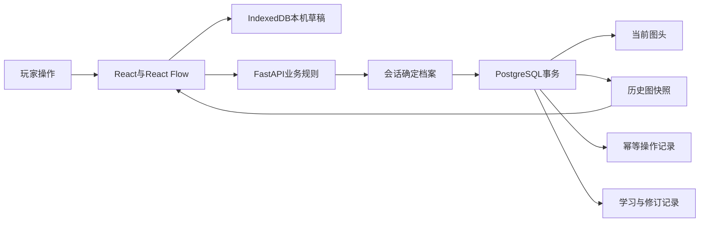

# 知行项目经历与介绍

更新于2026-11-11，面向AI全栈工程师。当前已有本机体验反馈、独立账号与存档，以及本地生产HTTPS演练。线上邀请内测仍待部署验收。

## 简历名称与定位

**知行 · AI知识探索与学习图谱平台**

角色为个人项目全栈开发，时间按首批开发记录写2026.11至今。面试围绕可交互的个人星图、可靠保存和学习记录追溯展开。技术栈为Next.js、React、TypeScript、React Flow、FastAPI、PostgreSQL、SQLAlchemy、Alembic和IndexedDB。

## 可放入简历的三条经历

面向AI初学者开发交互式学习应用，覆盖关卡探索、个人知识图谱、关系解释和独立存档。

- **个人星图交互。** 使用React Flow实现已发现知识的接入、关系与条件编辑、按章查看、版本差异和历史恢复，将9章37个探索点接入个人知识整理流程。
- **可靠保存。** 结合PostgreSQL事务、图头行锁、修订号校验和幂等键处理重复提交与多窗口冲突，使用IndexedDB保存按账号及标签页隔离的草稿，支持刷新找回和历史恢复为新版本。
- **账号与学习留痕。** 基于服务端会话隔离进度、星图和作答，固定关系验证时的原命题与题目版本，串联修订、变式挑战和反馈，通过双账号越权、并发提交及恢复流程检查。

版面更紧时，第一条保留“个人星图、版本差异和恢复”，删掉章节数量。第三条可以缩为“实现服务端会话与档案隔离，验证双账号越权和旧档迁移”。

## 30秒介绍

> 我做了一个面向AI初学者的知识探索应用。玩家完成小机关后，可以把发现接进自己的星图，写解释、补关系并保存历史。我重点做了星图编辑与可靠存档，处理多标签页冲突、网络重试、草稿恢复和账号切换。同时把学习作答绑定到当时的命题版本，让后续修改可以追溯。项目已完成本机体验和生产模式HTTPS演练，正在准备线上邀请内测。

## 2分钟介绍

> 我希望解决的是初学者把零散知识串成关系时，搜索和整理成本较高的问题。产品先让玩家在小机关中观察一个变化，再把自己的解释放进个人星图。每次只展开当前可达目标，目录和历史放在主动打开的入口。
>
> 前端采用Next.js、React和React Flow，后端用FastAPI统一验算与保存，PostgreSQL存储图谱快照、学习事件和账号。最有代表性的功能是星图保存。同一个人可能开多个窗口，也可能遇到请求超时，所以保存请求同时带基础修订号和操作键。服务端在事务内锁定当前图头，先查操作键，再检查版本，成功后追加快照并更新图头。重复请求得到原结果，旧版本提交得到409。
>
> 前端在IndexedDB里暂存草稿，账号和标签页进入存储键。冲突时先展示服务器与草稿，用户确认后再提交新版本。历史恢复也走同样的保存边界，因此旧版本能够继续回看。
>
> 另一个重点是学习记录的语义。作答固定当时的题目、命题和条件，修改关系后旧证据会标记需要重新核对。选择题计算与自由解释复核分别记录。当前已有9章探索、4类关系模板和独立账号，本机备份恢复与HTTPS生产演练通过。下一步是线上部署、真实试学，以及在可追溯内容上接入检索和分层提示。

## 五分钟演示脚本

1. 用已探索过的账号打开“我的星图”，选择一个知识节点，展示自己的解释。
2. 选择一条连接，补充关系命题和成立条件，保存并指出新修订号。
3. 开第二个标签页。在两边基于同一版本编辑，先保存第一边，再保存第二边，展示409和草稿对照。
4. 打开历史版本，比较命题变化，再恢复为新版本，说明旧历史仍可回看。
5. 从已有关系来源回看作答、修订与挑战。最后展示切换账号后的独立进度。

演示前用专用演示账号准备已发现节点。画面未出现某知识时，先检查探索进度和章节筛选。演示断网前先保留输入，恢复连接后核对保存结果。

## 结构与数据流

公共内容版本、个人图谱历史、探索会话和验证记录分别建模。React Flow负责交互，个人图按有界JSON快照保存。新情境作答固定题目副本和关系签名，复核意见与修订追加保存。核心文件见[实现证据](./resume-evidence.md)。

## 可以深入的工程问题

| 问题 | 实现选择 | 取舍 |
| --- | --- | --- |
| 两窗口同时保存 | 图头行锁串行化写入，基础版本检测陈旧输入 | 同图高频写会竞争，适合当前手动保存的小图 |
| 保存成功但响应丢失 | 操作键与请求摘要关联原结果 | 需要保留操作记录并正确复用原键 |
| 刷新或切换丢输入 | 按账号、标签页、入口排队暂存草稿 | 存储清理、配额、标签页身份丢失影响恢复 |
| 恢复历史与审计 | 复制历史载荷形成新版本 | 快照长期增长，需要后续归档策略 |
| 图改变后证据失真 | 固定关系五字段，当前读取时核对 | 原文比对较保守，等价改写也可能需要重验 |
| 学习者与复核者权限 | 学习会话和绑定档案的复核钥匙分别解析 | 当前复核身份按单档案配置 |

## 当前口径与后续设计

项目已实现的AI相关内容包括数值机制、学习任务、知识关系和评价留痕。RAG、模型调用和多Agent编排处于设计阶段，适合在面试中作为下一步方案展开。正式上线、真实用户规模、响应延迟和吞吐量需要在目标环境测量。

开发过程使用AI辅助。面试时可以直接说明自己负责的需求判断、实现取舍、代码审阅、复现与验收过程。逐项核实是否能现场解释或修改所选代码，再决定简历使用“实现”“设计”或“主导”等词。
