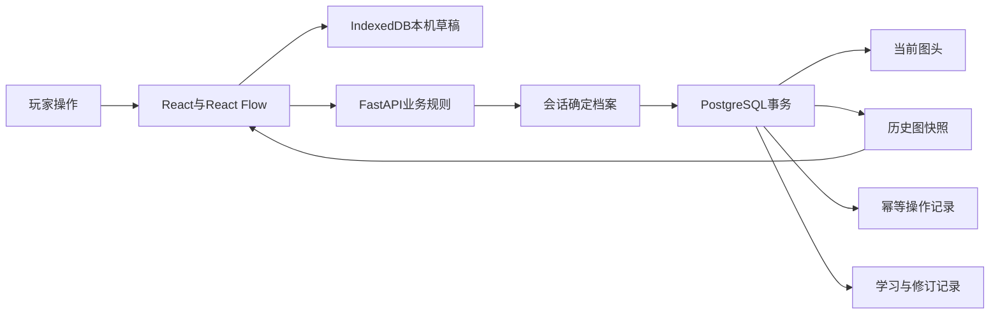

# 知行项目经历与介绍

更新于2026-11-11，面向AI全栈工程师。当前已有本机体验反馈、独立账号与存档，以及本地生产HTTPS演练。线上邀请内测仍待部署验收。

## 简历名称与定位

**知行 · AI知识探索与学习图谱平台**

角色为个人项目全栈开发，时间按首批开发记录写2026.11至今。面试主线是个人星图中的并发写入、跨账号草稿恢复，以及图谱与学习证据的一致性。技术栈为Next.js、React、TypeScript、React Flow、FastAPI、PostgreSQL、SQLAlchemy、Alembic和IndexedDB。

## 可放入简历的项目介绍与亮点

面向AI初学者的**闯关式学习应用**，将互动关卡与**个人知识星图**结合。玩家边闯关边连接知识、补充解释，逐步形成自己的知识地图。目前覆盖9章37个探索点。

- **知识能连起来，历史能找回来。** 基于React Flow实现知识连接、解释编辑和按章查看；**筛选只改变显示范围**，保存时保留完整图谱。支持版本对比，恢复历史时**新增版本，保留旧记录**。
- **多个窗口保存，先发现冲突再处理。** 使用**行锁与版本校验**拦截旧版本覆盖，让玩家先对照差异；使用**幂等键识别同一次保存**，服务端已保存但响应丢失时，重试返回原结果。
- **刷新找回草稿，切换账号分别保存。** 使用IndexedDB暂存未提交内容，按**账号与标签页隔离草稿**；写入排队前固定归属，切换前等待写入完成，处理异步写入遇上账号切换的问题。
- **修改知识关系，留下当时的依据。** 作答保留**当时的命题和题目版本**；修改关系时，校验图谱、作答与复核记录是否变化，将新图和修订记录**在同一事务保存**，便于回看修改原因。

先用介绍交代“谁来用、怎么玩、有什么用”，再用每条亮点说明“玩家遇到什么问题、具体怎么解决”。加粗只标出核心能力和关键做法。幂等指同一逻辑操作重试返回原结果；409表示当前输入基于陈旧版本，或操作键被用于不同内容。这里没有宣称自动合并、任意故障下不丢数据或高并发性能成果。

## 技术亮点对应的追问入口

| 简历中的技术点 | 第一问 | 继续深入 | 准备的证据 |
| --- | --- | --- | --- |
| 行锁、版本与幂等检查顺序 | 加了行锁，为什么还需要版本号？ | v3保存为v4后响应丢失，重试为何不能先查版本？为何同键需要摘要？ | 两窗口同基线提交、同键重试与换内容拒绝；问答第11—17题 |
| 草稿键固定与异步写入队列 | 账号ID进入存储键，为什么还可能写错账号？ | A账号写入排队期间切到B，执行时再取账号会怎样？等请求成功和等事务完成有何区别？ | 草稿存储代码、切换前等待、账号回切回归；问答第4、9、10题 |
| 三类版本与同事务提交 | 图保存成功，但修订记录失败，会出现什么？ | 复核意见在用户编辑时变化怎么办？以后再改意见，旧修订依据是否跟着变化？ | 图谱、作答、复核三类版本冲突及历史依据冻结；问答第22、23题 |

每条回答依次讲一个真实场景、原先可能出错的时序、当前实现、检查方法和剩余限制。不要只背技术名词。完整快照适合当前有界小图；当前项目也没有通用死锁重试器或自动解决编辑冲突的算法。

## 30秒介绍

> 我做的是一个**面向AI初学者的闯关学习应用**。玩家通过小互动理解概念，再把发现连进自己的**知识星图**，补充解释并回看修改历史。我重点做了编辑和保存：多个窗口修改时先提示冲突，网络响应丢失后可以重试，刷新后能找回本机草稿。另外，修改知识关系会保留当时的作答和复核依据，方便回看为什么这样改。项目已完成本机体验，线上邀请内测待部署。

## 2分钟介绍

> 我希望解决的是初学者把零散知识串成关系时，搜索和整理成本较高的问题。产品先让玩家在小机关中观察一个变化，再把自己的解释放进个人星图。每次只展开当前可达目标，目录和历史放在主动打开的入口。
>
> 前端采用Next.js、React和React Flow，后端用FastAPI统一验算与保存，PostgreSQL存储图谱快照、学习事件和账号。最有代表性的功能是星图保存。同一个人可能开多个窗口，也可能遇到请求超时，所以保存请求同时带基础修订号和操作键。服务端在事务内锁定当前图头，先查操作键，再检查版本，成功后追加快照并更新图头。重复请求得到原结果，旧版本提交得到409。
>
> 前端分开管理服务端确认版本、当前编辑和IndexedDB草稿。草稿写入排队前固定账号与标签页对应的键，切换前等待事务完成，处理异步写入遇上身份切换的问题。冲突时先展示服务器与草稿，用户确认后再提交新版本。历史恢复也追加版本，因此旧历史能够继续回看。
>
> 另一个重点是图谱与学习证据的一致性。用户编辑期间，图、作答记录和复核意见都可能变化，所以修订同时检查三个版本，并把图快照、操作和修订事件放在同一事务。事件冻结原命题与当时复核依据，后续修改意见不会改变旧修订的理由。修订本身也不直接算理解通过。当前已有9章探索、4类关系模板和独立账号，本机备份恢复与HTTPS生产演练通过。下一步是线上部署、真实试学，以及在可追溯内容上接入检索和分层提示。

## 五分钟演示脚本

1. 用已探索过的账号打开“我的星图”，选择一个知识节点，展示自己的解释。
2. 选择一条连接，补充关系命题和成立条件，保存并指出新修订号。
3. 开第二个标签页。在两边基于同一版本编辑，先保存第一边，再保存第二边，展示409和草稿对照。
4. 打开历史版本，比较命题变化，再恢复为新版本，说明旧历史仍可回看。
5. 从已有关系来源回看作答、修订与挑战。最后展示切换账号后的独立进度。

演示前用专用演示账号准备已发现节点。画面未出现某知识时，先检查探索进度和章节筛选。演示断网前先保留输入，恢复连接后核对保存结果。

## 结构与数据流

公共内容版本、个人图谱历史、探索会话和验证记录分别建模。React Flow负责交互，个人图按有界JSON快照保存。新情境作答固定题目副本和关系签名，复核意见与修订追加保存。核心文件见[实现证据](./resume-evidence.md)。

## 可以深入的工程问题

| 问题 | 实现选择 | 取舍 |
| --- | --- | --- |
| 两窗口同时保存 | 图头行锁串行化写入，基础版本检测陈旧输入 | 同图高频写会竞争，适合当前手动保存的小图 |
| 保存成功但响应丢失 | 操作键与请求摘要关联原结果 | 需要保留操作记录并正确复用原键 |
| 刷新或切换丢输入 | 按账号、标签页、入口排队暂存草稿 | 存储清理、配额、标签页身份丢失影响恢复 |
| 恢复历史与审计 | 复制历史载荷形成新版本 | 快照长期增长，需要后续归档策略 |
| 图改变后证据失真 | 固定关系五字段，当前读取时核对 | 原文比对较保守，等价改写也可能需要重验 |
| 学习者与复核者权限 | 学习会话和绑定档案的复核钥匙分别解析 | 当前复核身份按单档案配置 |

## 当前口径与后续设计

项目已实现的AI相关内容包括数值机制、学习任务、知识关系和评价留痕。RAG、模型调用和多Agent编排处于设计阶段，适合在面试中作为下一步方案展开。正式上线、真实用户规模、响应延迟和吞吐量需要在目标环境测量。

开发过程使用AI辅助。面试时可以直接说明自己负责的需求判断、实现取舍、代码审阅、复现与验收过程。逐项核实是否能现场解释或修改所选代码，再决定简历使用“实现”“设计”或“主导”等词。
