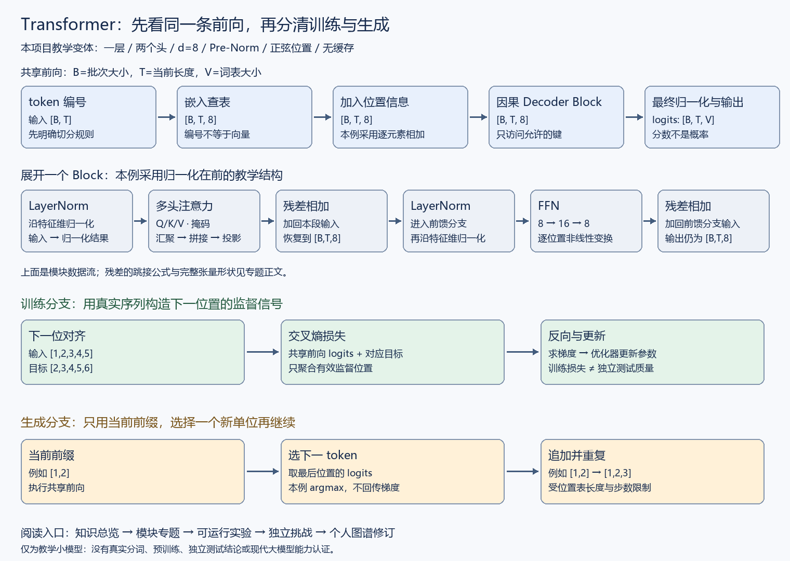
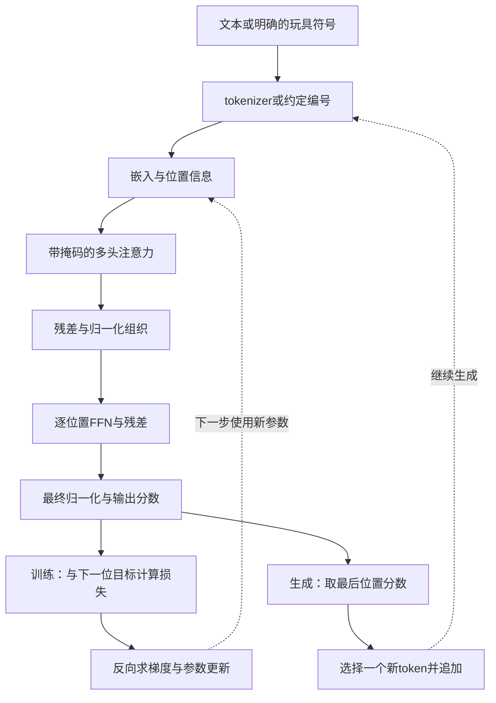

# Transformer专题：把一条计算链真正接通

状态：中文专题草稿，包含自制图解、模块文档、教学小模型及任务设计；尚无游戏界面或学习效果验证。

Transformer（一类以注意力机制为核心的神经网络架构）在本专题中采用一个明确的教学变体：**因果解码器、单层双头、Pre-Norm、正弦位置、ReLU前馈网络**。它不是2017年完整编码器—解码器的复刻，也不代表现代所有架构。

Pre-Norm（先归一化再进入子层的结构）、ReLU（取输入与0中较大值的激活函数）按需展开；初学者每轮只需理解当前小目标。

## 1. 一张图看清数据去向



[打开可缩放SVG](./assets/flow.svg)。图为本项目自制，对应 `examples/tiny_transformer.py` 的教学结构，未复制参考站图片。



这张概念图省略内部顺序；准确的残差跳接按模块公式和代码阅读。生成追加的是已有词表编号，不需要把整段重新训练成词表。

## 2. 用一个具体样本贯穿

模型处理的是玩具编号，不是自然语言分词结果：

- 完整序列为 `[1,2,3,4,5,6]`。
- 训练输入为 `[1,2,3,4,5]`，对应监督目标为 `[2,3,4,5,6]`。
- 每个输入位置仅能访问当前及之前位置，不能读到目标位置的未来信息。
- 训练时按有效位置计算损失，反向求导并更新参数；输入与目标的对应称“下一位对齐”。
- 生成时从 `[1,2]` 开始，只取最后位置分数选择一个新编号，再追加到前缀。

训练把真实历史输入各位置进行并行计算，不等于生成时能预先知道未来答案。

## 3. 按问题展开模块

| 现在想弄懂什么 | 展开哪里 | 需要留下的理解证据 |
| --- | --- | --- |
| 编号怎样变成向量？ | [嵌入与位置](./input-and-position.md) | 区分编号、向量和位置；计算查表与相加 |
| 一个头怎样变成多个头？ | [多头、投影与掩码](./multihead-and-mask.md) | 追踪每一维度，解释拼接和输出投影 |
| 为什么形状一样还能学到东西？ | [残差、归一化与FFN](./block-components.md) | 区分token间汇聚与逐位置变换 |
| 怎样避免偷偷看答案？ | [训练与生成](./training-and-generation.md) | 区分可见性、目标右移、忽略项和独立测试 |
| 怎样验证是理解而非背答案？ | [任务与过关规则](./missions.md) | 独立变式、解释关系与修订个人图谱 |

不要求依表顺序通读。有基础者通过对应挑战后直接进入断点；未来系统按画像呈现局部任务。

## 4. 运行与观察

在项目根目录运行：

```powershell
python examples/tiny_transformer.py
python -m unittest discover -s tests
```

环境实测为Python 3.13.14、PyTorch 2.14.0+cpu。模型代码需要PyTorch；资料采用固定版本官方文档作接口依据，两者版本分别记录。未自动安装依赖或下载模型。

本模型共696个可学习参数。结构包括输入嵌入、显式Q/K/V投影、多头拼接与输出投影、两条残差分支、LayerNorm（沿指定特征维进行归一化的层）、两层FFN（逐位置前馈网络）、输出头。没有KV缓存、Dropout、权重共享或大规模训练设施。

实测固定种子7、CPU、100步SGD（随机梯度方法；本例每步使用同一合成小批次）后，训练损失由约2.054降到0.0217；生成 `[1,2,3,4,5]`。这些结果只验证指定合成模式的拟合，不报告泛化、真实文本或大模型能力。

## 5. 当前完成与缺口

已具备：自制流程图、模块机制草稿、可检查的完整教学前向/反向/更新/生成流程及自动检查。

待补：真实tokenizer、单独的RoPE/RMSNorm/现代FFN深入档案、多层和缓存实验、独立数据评价、可操作游戏界面、个人图谱持久化、自适应任务呈现及真实试学。

## 6. 资料

[原始Transformer第3节](https://arxiv.org/html/1706.03762v7)用于原架构与模块核查；实现中的教学变体已另行标记。模块接口与边界见各篇官方来源。参考站只提供组织经验，见[对标记录](../../../docs/site-benchmark.md)。
